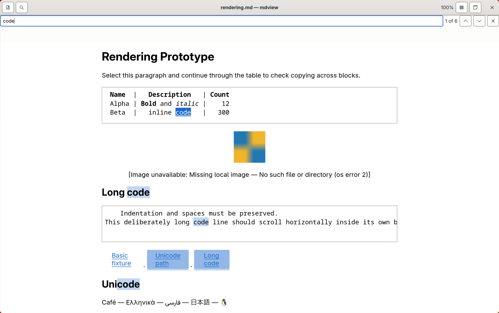
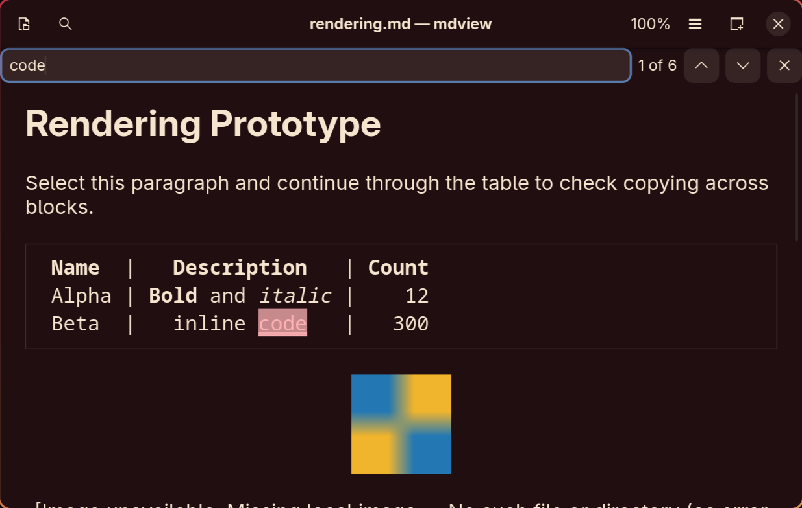
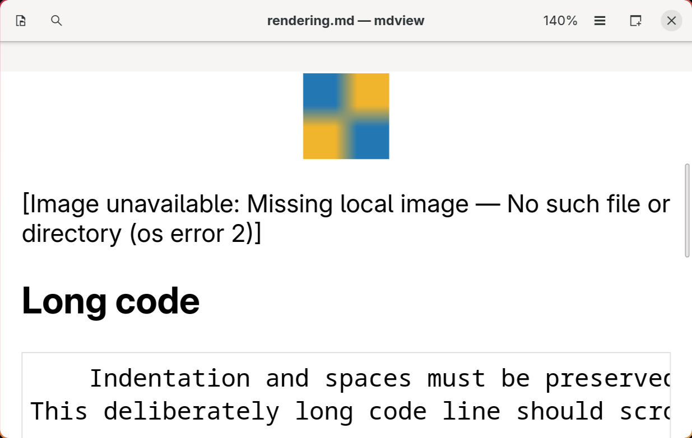
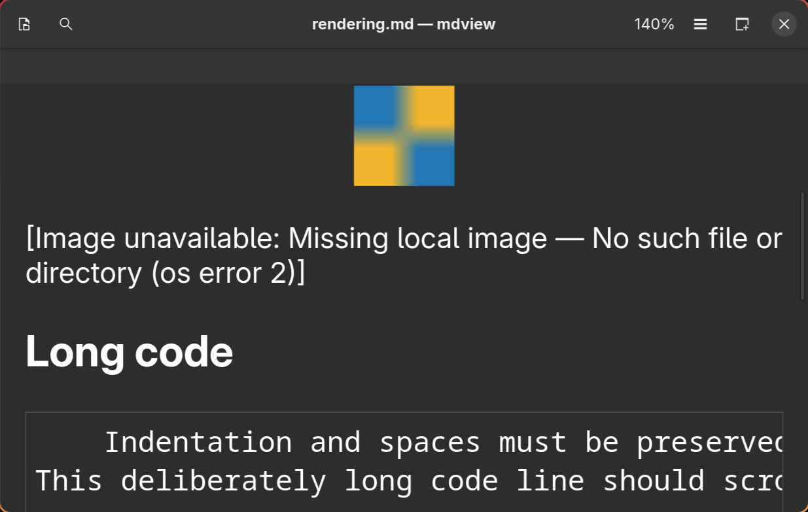
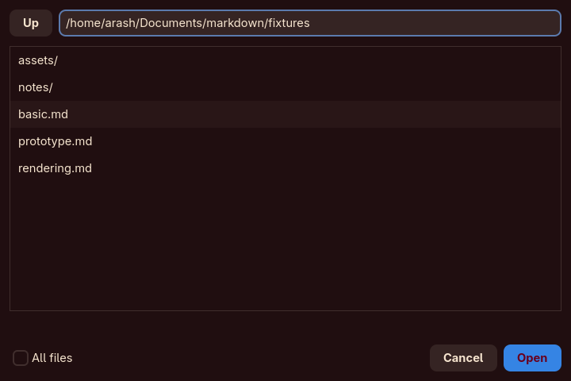
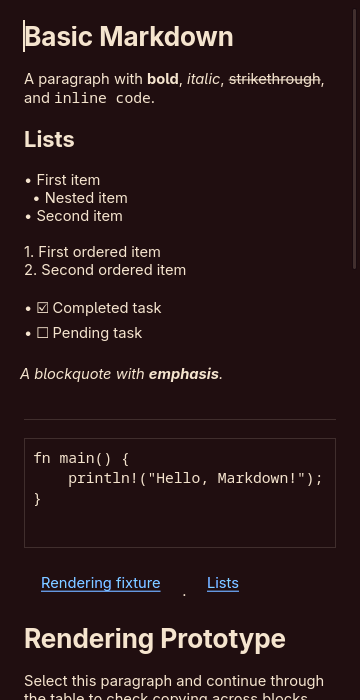
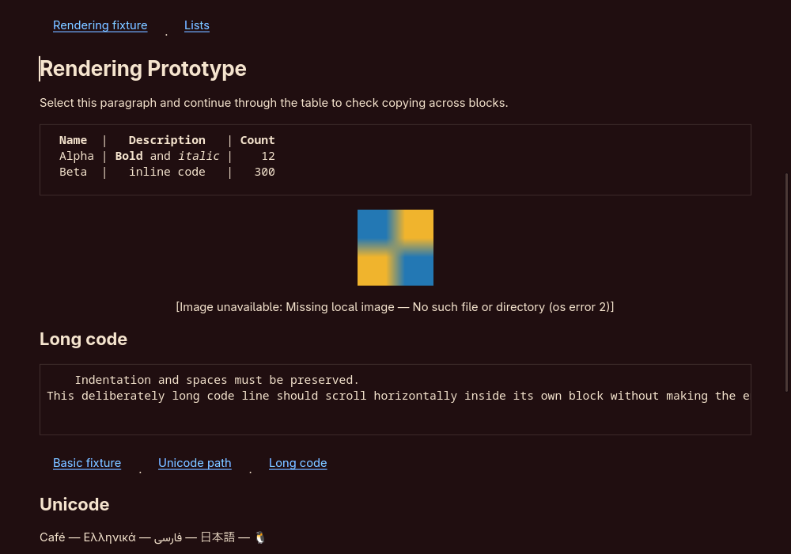
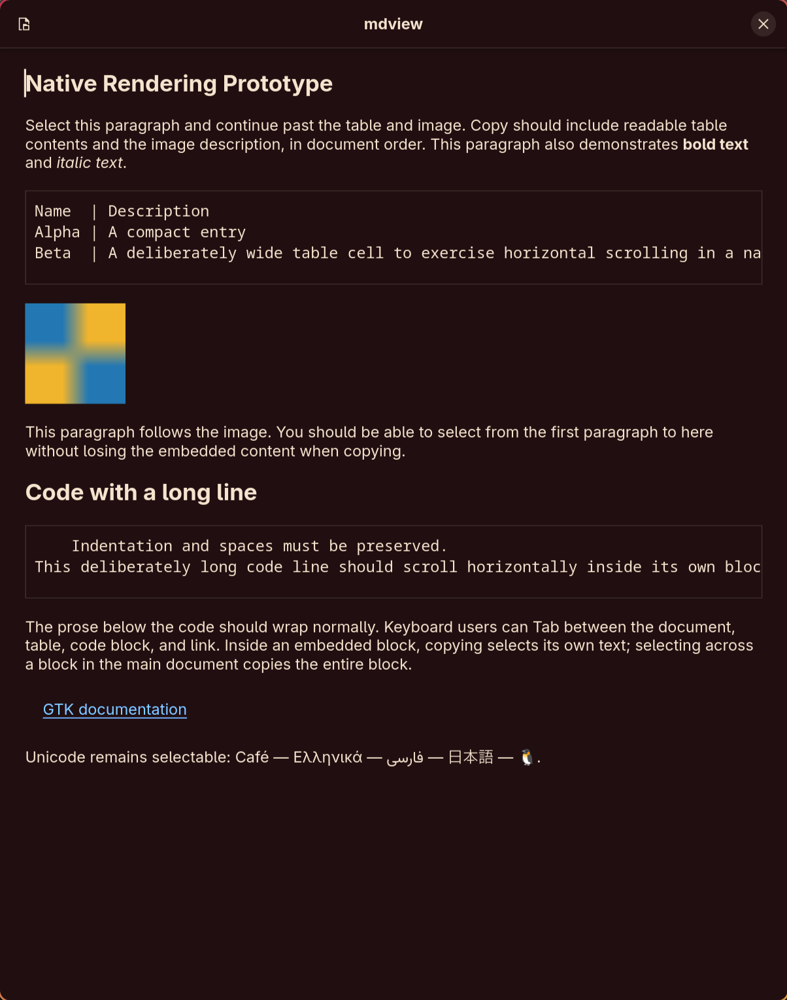

# Native Rendering Prototype Results

The application retains GTK's default renderer and the approved 180 MB RSS budget. Step 4 replaced direct parsing with the document model, and Step 5 connected file opening and safe navigation, and Step 6 added reading controls/preferences. Step 7 retained-memory acceptance is complete on the reference GNU/Linux desktop; transient peaks are reported explicitly. Earlier measurements below remain historical references.

## Release validation (Step 9 complete)

Current release evidence, native install/uninstall, startup measurements and known
limits are in [RELEASE_VALIDATION.md](RELEASE_VALIDATION.md). The user selected MIT;
the license and short guide are installed through the Makefile. Final 100 KB
fresh-process captures show readable content in 827.00–896.04 ms (median 865.09 ms)
at 1520 × 956, with OS caches warm/uncontrolled. The user explicitly accepted these
fresh-process results for the startup criterion. Cold OS-cache performance remains
unperformed. All five captures were
inspected. After zoom/reset, resizing and three picker cycles, fixed settled RSS
is 156.219 MiB / 163.807 MB, with a sampled process-tree peak of 165.356 MB during
those operations. The default renderer and 180 MB idle budget are unchanged.

The release build is reproducible offline into an empty target directory with an
identical executable hash. All 16 tests and required build/lint checks pass. The
actual Makefile install/uninstall and native Wayland/Xwayland launch pass in a
disposable prefix, including the guide and MIT license, preserving unrelated files
and original MIME defaults. A Linux x86-64 ptrace check with Unix/Internet control
cases observes only Unix IPC when opening a fixture with local images, blocked
remote images, raw HTML and inactive web/mail links. No source change is observed.
Speech, physical gestures, actual external handlers and broader performance limits
retain their documented scope. Final release return-from-5-MB prose/code idle
samples are **162.05 / 169.93** and **166.92 / 175.03** (MiB / MB), both below the
unchanged 180 MB budget; no children remain at checkpoints. Final picker idle is
166.24 / 172.54 MB. Large-use peaks are separately recorded at 226.59 / 227.70 MB.
Historical statements about Step 9 not being
started below describe earlier sessions.

## Accessibility and desktop integration (Step 8)

Current AT-SPI inspection on a temporary accessibility bus reads full Unicode prose, aligned table text and indented code, image alt/error descriptions and native links in document order. The raw tree and real-key result flags are in [step8-accessibility.json](step8-accessibility.json). Reproduce with `python scripts/check_accessibility.py` after a release build. The script uses a disposable config and bus, and guards input against focus loss. Real Find/next/Escape, picker open/cancel, zoom/reset and Tab/Enter heading activation pass. Existing regressions continue to cover read-only copy, embedded focus traversal and opening/navigation.

Search counts now expose their changing text through a Status role instead of a fixed accessible name. Notices also use Status; toolbar/menu/search icon controls have explicit labels. These are accessibility semantics, not proof of spoken announcement delivery. The normal desktop accessibility bus still refuses connections. **Orca is not installed**, so speech, announcement timing and a full screen-reader usability review remain unavailable. Tables expose selectable aligned text rather than semantic row/cell navigation; headings remain styled text with navigation marks, without a screen-reader heading hierarchy.

System font changes now recompute zoom from inherited font settings and remeasure embedded blocks. A GTK regression changes to Sans 22 during reading, switches to HighContrast with a manual Dark preference, and verifies **13.77:1** document foreground/background contrast. HighContrast and HighContrastInverse (including explicit `GTK_THEME`) take priority over manual palettes; the saved choice resumes afterward. Active search uses opaque native selection colours and a double underline; embedded link highlights also use the matching selected foreground. Search/notices never animate, including when GTK reduced motion disables animations. Existing Light/Dark/System tests remain passing. The app-only screenshot below was inspected for large-font content, focused Find, contrast and embedded layout; long code keeps its own horizontal scroller.



`data/` contains a freedesktop entry, scalable application SVG and shared-mime-info declarations for `.md`, `.markdown`, `.mdown`, `.mkd` and the `text/x-markdown` alias. The entry launches `mdview %F` via PATH with executable activation (`DBusActivatable=false`); the existing GApplication handles activate/Open and forwarding. No `.service` file is needed. Wayland uses `io.github.arash.mdview`; the actual X11 class is `mdview`, reflected in StartupWMClass. There is no MIME-default registration.

`python scripts/check_desktop.py` makes a disposable local prefix, validates the desktop file, generates temporary desktop/MIME caches and launches via `gtk4-launch`. It then uses `gio launch` with basic.md and `Unicode café.md` to exercise the desktop-file launch API used by file managers, including replacement/forwarding and one document per window. Both native Wayland and **X11 via Xwayland** pass. A standalone Xorg session is unavailable; actual file-manager GUI gestures remain unperformed. Raw desktop results are saved in [step8-desktop.jsonl](step8-desktop.jsonl). The script removes the prefix and verifies existing defaults unchanged (Markdown: Kate; alias unset). No user config/service/default application is changed. Release installation and packaging are deferred to Step 9.

All 16 tests and formatting/check/strict Clippy/release build pass. The extended full run's large-file heartbeat gaps were 21.62 ms prose/search and 17.88 ms fenced code. Real pointer selection/drop, full speech-reader review and actual external browser/mail/file handlers remain manual limits. Step 8 adds no new performance acceptance result; Step 7's unchanged 180 MB idle acceptance, GNU-libc scope and transient/picker headroom limits still apply. **Step 9 has not started.**

## Automatic reload and 5 MB handling (Step 7 complete)

GIO `WATCH_MOVES` directory monitors match either endpoint of changes to the document entry. Logical entries and resolved symlink targets are both monitored, with parent resolution preserving `..` and filesystem symlink semantics. Ordinary writes, atomic replacement, 20-save bursts, deletion/recreation, rename away, invalid UTF-8 recovery and Retry are exercised through real notifications. Saves debounce for 150 ms; no application polling is introduced. Navigation/close cancels old monitors and queued work. A post-installation inode/device/size/mtime check catches changes during initial reading/presentation.

Reads/parsing remain workers. Native rendering runs cooperatively on GTK's thread into an unattached replacement, keeping the last readable document available until success. Superseded futures are aborted and worker generations reject stale results. UTF-8-safe 8 KiB inserts and bounded traversal yield for input, including code blocks and table loops. Read-only buffers disable undo history. Completed models are retired on a worker. The original scroller and zoom-CSS lifecycle remain unchanged; experiments with reusing them did not resolve memory retention and were removed.

Reload captures the current viewport just before replacement. It restores the nearest surviving heading plus relative line offset after allocation; missing headings use a proportional fallback. An open query is recomputed without stealing the restored viewport. Explicit opens still start at the top, now covered after a scrolled reload as well.

Search debounces 150 ms and snapshots in bounded chunks. A cancellable worker streams Unicode case-folded characters through a KMP matcher, using query-sized prefix/history arrays instead of a document-sized folded string and offset map. Original character offsets, expansion/nonoverlap semantics, full counts and navigation are preserved. The first 1,000 hits plus the active hit receive highlights, with the limit explained in the tooltip. Hiding search releases hit/index vector capacity.

### Memory attribution and fixes

The prior failure was **197.00 MiB / 206.57 MB** after returning from 5 MB to a small file. This session reproduced 204.62 MB. Loading-only and persistent-virtual-keyboard comparisons still retained excess memory. Diagnostic allocator statistics showed roughly 27 MB of free space in the main heap after large native buffers were retired, pinned among surviving GTK/font/input allocations. A diagnostic reclamation probe reduced 204.24 MB to 178.80 MB.

`DocumentView` now detects large retirement (at least one million main-buffer characters or one million bytes of embedded copy text). On GNU/Linux, it coalesces a retiring widget tree into a temporary 100 ms callback, then calls glibc `malloc_trim(0)` on a GIO worker after widget retirement. Picker close requests the same reclamation. It returns allocator-owned free pages; GTK disposal stays on its owning thread and no GTK object crosses threads. The call is [documented as thread-safe](https://man7.org/linux/man-pages/man3/malloc_trim.3.html). Other libc targets use a no-op and are not covered by this memory acceptance. There is no allocator replacement/tuning or permanent application timer. This deliberately revises the earlier session's no-allocator-FFI restriction after attributing the retained free heap.

Full process-tree accounting uncovered another issue: the old main-thread-only `/proc/PID/task/PID/children` check missed an approximately 11 MB GdkPixbuf/Glycin decoder process tree attached to a worker. Repeated reloads also scheduled image jobs for already retired views. Queue/thread-lifetime experiments alone did not make the platform process lifecycle budget-safe. Earlier statements that there were no children must be read with that measurement limitation.

The application image path now uses **`image` 0.25.10**, with default features disabled and only PNG, JPEG, GIF, BMP and PNM enabled. A forced format follows the existing signature/header checks; there is no extensible loader or URI interpretation. Existing regular-file/nonblocking checks, bounded 8 MiB reads, dimensions ≤16,384, the 16-million-pixel cap, GIF animation rejection, raster-only policy, once-only path decoding and 1024 × 768 retained-pixel limit remain. The reader configures a 256,000,000-byte allocation limit for high-depth intermediates. The library documents `max_alloc` as decoder-dependent/non-strict, so this is not a hard total-process allocation cap; the explicit file, dimension and pixel checks remain the strict bounds. Decode/resize stays on GIO workers; native GTK `MemoryTexture`/Picture presentation remains unchanged. This removes the application decoder subprocess and its retained platform runtime. GTK itself still owns its normal platform behavior; measurements count any descendants rather than assuming none.

A per-GTK-thread image queue permits **one active decoder job**. Pending jobs hold weak widget/label references and skip retired requests before decoding, avoiding a backlog of obsolete workers. A regression holds the decoder busy, retires 50 queued image widgets, and proves that only the surviving queued image is decoded. Format tests now include valid PNG/JPEG/GIF/BMP/P6 data, PNG alpha, scaling, unchanged encoded bytes and the existing malformed/oversized/security cases. The existing P1–P6 policy is preserved; PAM/P7 remains outside it.

Cargo.toml and Cargo.lock add the raster dependency and its locked transitive packages. All previously locked package versions/checksums are preserved. The new packages were fetched once into the workspace Cargo home; all final checks run locked and offline. No helper executable, renderer override, desktop configuration change, document truncation or source-document write path was added. The picker retains its original **720 × 480** default and all behavior; size experiments were removed.

### Reload and picker transients

Free-heap retention and driver-backed caches are separate effects. In one diagnostic reload-only run, RSS fell from 179.02 MB to 167.26 MB during three further idle seconds without heap reclamation. `/dev/nvidiactl` resident mappings fell by 5,744 KiB while anonymous resident memory was unchanged; an extra trim recovered only 304 KiB. This correlates that transient with driver mappings; it does not account for every byte or establish a driver leak diagnosis.

[GTK 4.24.1's GPU device source](https://raw.githubusercontent.com/GNOME/gtk/4.24.1/gsk/gpu/gskgpudevice.c) sets a 15-second cache-GC period. Cached or still-referenced surfaces can outlive a redraw; the timeout alone is not a guarantee of reclamation. The profiler keeps the one-second samples and observed transient peaks, adds fixed 20-second reload idle and 31-second picker samples, and **preserves the requested 20-second return-from-large-file sample**. It never waits until RSS happens to pass. The budget remains 180 decimal MB for a settled typical document, not an instantaneous peak cap. GTK's cache timeout and default renderer are unchanged.

### Final release measurements

Reference hardware/software remains the Step 2 machine below. Both final runs used the same release binary (SHA-256 recorded in the raw data), GTK's default renderer, **1520 × 956** logical allocation, disposable source/preferences, and the user's GTK configuration linked for reading. An empty temporary workspace supplied the reference allocation; the previous workspace was restored. Thirty alternating ordinary/rename-over saves, real Find/Escape/Ctrl+Home, native picker cancellation and CLI return to the small Unicode fixture were exercised. No user source, persistent preferences or desktop configuration changed. The prose fixture was 5,000,082 bytes; fenced code was 5,000,104 bytes.

Values are **MiB / decimal MB**, from `/proc/PID/status`, including remaining descendants at every checkpoint:

| State | Prose run | Fenced-code run |
| --- | ---: | ---: |
| Initial, one second | 167.98 / 176.14 | 167.66 / 175.80 |
| 30 reloads, one second | 161.29 / 169.13 | 160.86 / 168.67 |
| 30 reloads, 20 seconds idle | 159.45 / 167.20 | 159.87 / 167.63 |
| Normal picker cancellation, one second | 171.07 / 179.38 | 171.48 / 179.81 |
| Normal picker cancellation, 31 seconds idle | 171.07 / 179.38 | 171.52 / 179.85 |
| 5 MB document and search | 188.68 / 197.85 | 218.20 / 228.80 |
| Return to small file, one second | 163.38 / 171.31 | 167.98 / 176.14 |
| Small file, 20 seconds idle | 163.38 / 171.31 | 167.98 / 176.14 |
| Final picker cancellation, one second | 159.61 / 167.36 | 165.80 / 173.85 |
| Final picker cancellation, 31 seconds idle | 159.61 / 167.36 | 166.62 / 174.71 |

Both runs pass all fixed idle checkpoints under the unchanged 180 MB budget. There were no child processes at any final-run checkpoint and both quit with status 0. Raw evidence: [prose](step7-memory-prose.jsonl), [fenced code](step7-memory-code.jsonl). Observed main-process reload peaks were **180.91 / 180.45 MB**; large-use peaks were **223.39 / 228.80 MB**. Largest sampling gaps were 15.16 / 16.08 ms. The fast sampler targets 10 ms and samples the main process; checkpoint totals recursively include children from all worker threads. These are observed peaks, not exhaustive process-tree maxima. The 5 MB target is responsiveness, not typical-document RSS. Normal picker headroom is narrow (179.85 MB in the code run); repeat picker and zoom/resize RSS profiling during Step 9.

Reproduce with no existing mdview instance, keeping it focused and its geometry stable:

```sh
export CARGO_HOME="$PWD/.cargo-home"
cargo build --release --locked --offline
python scripts/measure_reload.py --output /tmp/mdview-prose.jsonl
python scripts/measure_reload.py --large-kind code --output /tmp/mdview-code.jsonl
```

Use new output paths and allow about two minutes per run. The script records exact bytes, MB/MiB, transient/idle samples, image kind/size, executable hash, descendants and window/picker geometry. It validates title completion, stops keyboard input if mdview loses focus, and exits nonzero for failed idle RSS or changing geometry.

All **16 tests**, formatting, offline locked check, strict Clippy and release build pass. Final GTK maximum main-loop gaps: **16.48 ms** for prose/search and **17.96 ms** for code (existing ceiling 250 ms). Existing reload/recovery, viewport, picker, navigation, copying, preferences and appearance regressions remain passing. New weak-reference checks prove release of large prose views/buffers and code views. Known accessibility-bus refusal and occasional frame warnings remain. Full screen reader/high contrast, real pointer dragging/drop and actual external handlers remain unperformed. Pathological unbroken lines, huge link labels, deep nesting and image/table-heavy 5 MB files lack comprehensive profiling. Cold-launch/100 KB and zoom/resize peak validation remain Step 9. **Step 8 has not started.**

## Reading controls and preferences (Step 6)

Find indexes rendered text in document order, including embedded tables/code, formatted link labels and image descriptions. It uses GTK's Unicode case-insensitive literal search, counts nonoverlapping matches, wraps next/previous, and maps hits to buffer tags/widget backgrounds without changing copy selection. Embedded hits scroll both their ancestor anchor and their local text view. Link destinations are excluded. That Step 6 implementation was synchronous; Step 7 replaces it with cooperative snapshots and cancellable worker matching, described above.



Text zoom is 50–200% with 10-point increments/reset and embedded-height remeasurement. Appearance/zoom apply across windows; queries remain local. The compact menu provides System/Light/Dark and zoom actions. Native GTK Entry plus an unanimated Revealer avoids the extra allocations seen with SearchBar transitions. App appearance imports GTK's built-in named palettes and app role aliases, retaining desktop widget rules. Removing the provider restores System behavior without changing desktop settings or the renderer. Installing complete replacement widget themes had caused pixman damage warnings and excess renderer allocation here; the final palette-only implementation removes those warnings.





Preferences use a bounded GLib key file and atomic private GIO replacement under the user's XDG config directory. Missing/malformed/out-of-range fields use defaults. Size tracking observes changes in surface dimensions and saves the last non-fullscreen allocation; Hyprland reports tiled windows as maximized, so that state alone is not excluded. Restored dimensions are requested by GTK, with final allocation controlled by the compositor. Restart tests check the actual saved file and a new controller's requested size/zoom; real restart screenshots also verify Dark and 140%.

All 15 tests pass, including the prior parser/navigation/image/opening/picker/copy regressions and new preferences/reading checks. Real keyboard input verifies Find, next/previous (including shifted G key values), zoom/reset, Escape, close/quit and picker opening/selection/cancellation. Search screenshots were inspected at 1→2→1 matches. Full screen reader/high contrast, pointer dragging and actual desktop-handler launch checks remain unperformed. Final full tests emit the known accessibility-bus refusal and occasionally the existing discarded-frame warning; no pixman warning remains.

Final release measurement on the Step 2 reference machine, default GTK renderer: after reading controls, a theme/140% zoom restart, reset to System/100%, picker opening of basic/rendering/Unicode fixtures and cancellation, RSS one second later was **166.00 MiB / 174.07 MB**, with no child processes. Final selected file: `fixtures/notes/Unicode café.md`. Settled 140% rendering.md in that run sampled 176.66 MB. An earlier 0.25-second zoom/resize sample reached 180.24 MB; this session establishes representative idle samples, not a peak-memory bound. Step 9 must profile zoom/resize transients along with cold launch/100 KB/5 MB acceptance. Rejected intermediate complete-theme/search-transition implementations sampled about 195 MB and are absent from the final code. Test configurations were isolated under `/tmp` with the existing GTK config linked; no user desktop settings/preferences were changed.

## File opening and navigation (Step 5)

Normal launch opens local documents through the picker, a single-file drop, or CLI arguments. Each normal window uses the same controller/worker loading path and replaces its current document only after a successful read and parse. Errors preserve the document and offer Retry. New Window creates an empty window; CLI forwarding reuses the active normal window and opens additional arguments in separate windows. Preview mode remains fixture-only; New Window opens a normal window from it.

The local picker uses a native GTK Entry, virtualized ListView, SingleSelection, Up, All files and Open/Cancel controls. Directory/path operations run on GIO workers. Ctrl+L focuses the filesystem path entry; Enter opens it, row activation enters a directory or selects a file, and Escape cancels. Native paths are never URI-decoded. Directory responses are discarded after a newer request or a closed picker. This keeps large folder listings virtualized without introducing a browser runtime or additional dependency.



This picker addresses two measured constraints on the reference desktop: the portal backend failed path confirmation with GTK tree-model errors, while the stock in-process chooser retained about 186–196 MB RSS after repeated use. The Step 5 picker used no portal backend, deprecated chooser API, allocator workaround or helper process. Step 7 subsequently adds the close-time reclamation hook described above. Its representative release sample after opening basic/rendering/Unicode fixtures through real keyboard input and cancelling the next picker was **163.55 MiB / 171.50 MB**, measured from `/proc/PID/status` one second later with GTK's default renderer. The final selected document was `fixtures/notes/Unicode café.md`. This is one idle sample after repeated use, not a maximum over arbitrary files or a cold-launch/100 KB/5 MB acceptance measurement.

The library's navigation module decodes classified link paths/fragments once, uses filesystem APIs for local targets, opens Markdown internally and carries allowed external targets to the desktop launch boundary only after activation. Executable files, scripts and desktop shortcuts are rejected after checking resolved symlink targets. Missing-file, invalid-text, directory and launch errors preserve the current document. A valid Markdown file with a missing fragment opens and reports that heading error. Non-Markdown file fragments are ignored.

The final 14-test suite passes, including actual native picker callbacks for the same three fixtures, directory/Up/filter/error/cancel behavior, installed GDK FileList drop signals, GApplication opening and window lifecycle, failed-open preservation/retry, encoded relative navigation, headings, rejected targets and recording-launcher dispatch/error checks. Real release-process CLI checks and keyboard-driven picker selection/cancellation also pass. No real browser/mail/file-handler application was launched by the tests. Pointer dragging and full screen reader review remain for Step 8; the known desktop accessibility-bus refusal persists. Temporary snapshot instrumentation and measurement examples were removed from source.

## Step 4 renderer

`src/native.rs` renders the owned document tree into `DocumentView`. The `--prototype` preview now combines `prototype.md`, `basic.md`, and `rendering.md` through that renderer. File loading and external/local link dispatch now use the Step 5 pipeline described above. The preview's local images are read from the repository fixture directory.

All required syntax is represented: nested lists with ordered starts, noninteractive task glyphs, blockquotes, rules, headings, paragraphs, emphasis/strong/strikethrough, inline and block code, formatted aligned tables, images, links and heading destinations. A centered content column caps at 900 logical pixels; embedded tables and code keep independent scrolling. Table cells retain inline tags; the table remains aligned native text rather than a semantic grid. Native link buttons handle pointer hit testing and keyboard focus. Their default URI launching is always intercepted. Internal heading links decode fragments once and scroll to root-document marks, including from tables; other classified targets go to the caller's callback, currently inert in the preview.

Local images use filesystem paths after exactly one percent decode. Bounded regular-file reads and decoding run on GIO workers, with serialized allocations. Limits are 8 MiB encoded data, 16 million source pixels, dimensions at most 16,384, and retained textures at most 1024 × 768. Signature-based PNG, JPEG, static GIF, BMP and PNM decoding prevents indirect remote references; SVG and animated GIF are rejected along with remote, unknown, oversized and malformed sources. Missing/blocked/error states remain readable placeholders. Small images get a 96-pixel display height, while larger images shrink to the available width with a 480-pixel height bound.

The Step 2 copy contract remains: main selections expand crossed anchors in order; selections inside a table/code block stay local. Code retains the final newline as well as indentation. Main-buffer copies include formatted table contents as aligned plain text, image alt descriptions, rules, and link labels with classified encoded destinations. Literal U+FFFC characters survive. Continuous partial-block-to-prose selection is not supplied by this widget structure.





These GTK-rendered snapshots were inspected after correcting trailing-newline height accounting, nested-list spacing, image size, and wrapped link allocation. Full fixture checks passed at 360, 400 and 1000 pixels; the original 400/900/360 regression also passed. The test covers clipboard round trips, focus traversal, local images, error placeholders, encoded heading activation from prose and tables, and interception of default URI launching. Separate image tests cover malformed/oversized/missing inputs, animated GIF rejection, SVG with a remote image reference, unchanged bytes, and once-only path decoding. Parser tests remain nine display-independent tests. The GTK regression requires desktop/session-bus access. Step 7 replaced the platform raster decoder; its current raster unit checks run without a display.

Five release runs of the combined 2,742-byte preview on the Step 2 reference machine, with the same warm-cache mapping/RSS method and default renderer:

| Run | Mapped window in ms | RSS in MiB |
| --- | ---: | ---: |
| 1 | 323.8 | 158.07 |
| 2 | 322.7 | 158.25 |
| 3 | 351.1 | 157.82 |
| 4 | 328.4 | 158.12 |
| 5 | 304.1 | 158.12 |
| Median | 323.8 | 158.12 |

Maximum sampled RSS was about 165.94 MB, within 180 MB. No child processes remained at sampling. This is a preliminary fixture measurement, not final cold-launch/100 KB/5 MB acceptance or a peak-memory bound for arbitrary images.

No new full screen reader, pointer-drag selection, or picker checks were performed. The known desktop accessibility-bus refusal persists; one test run also emitted a discarded-frame timing warning without failing. Raster-only decoding and stopped URI defaults make no network requests in the renderer's code path; comprehensive runtime network tracing remains for Step 9.

## Step 2 historical setup

Close any existing mdview instance before switching modes. From the project directory:

```sh
export CARGO_HOME="$PWD/.cargo-home"
cargo run --locked --offline -- --prototype
```

At Step 2 this mode rendered only `fixtures/prototype.md`, with both Markdown and its image embedded in the binary. The original Open action was disabled, and normal launch retained the picker acknowledgement. The Step 4 preview described above supersedes this setup; the command remains the same.



## Widget structure

- An outer `GtkScrolledWindow` provides document vertical scrolling and suppresses document horizontal scrolling.
- A read-only `DocumentView`, subclassing `GtkTextView`, holds prose, text styling, and child anchors.
- Each table or code block is an embedded `GtkScrolledWindow` containing a read-only, unwrapped text view. Tables currently use aligned monospace text with a header row and ` | ` column separators. This prototype does not implement table cell formatting or semantic table navigation.
- Each block follows the main view's allocated width, keeping horizontal overflow inside the block. Short blocks reserve enough height for their lines and padding. Taller blocks are capped at 240 pixels and can scroll vertically.
- Images are embedded pictures with an accessible description. The one permitted image is compiled into the prototype. Other image destinations produce a placeholder.
- HTTP and HTTPS links use native link buttons. Other destinations are plain text in this prototype. General link classification and local navigation belong to later steps.

GTK's documented [child anchors](https://docs.gtk.org/gtk4/method.TextView.add_child_at_anchor.html) provide the embedding mechanism. Embedded objects occupy a position in the main buffer; a normal [buffer slice](https://docs.gtk.org/gtk4/method.TextBuffer.get_slice.html) represents them with a replacement character. The custom copy handler expands known anchors to their plain-text contents and preserves literal replacement characters in source text.

## Selection and copying

Selections in the main document can cross paragraphs and whole embedded blocks. Copying such a selection includes table rows, code, image descriptions, and link labels and targets in document order. Table rows become aligned text; code indentation is preserved; images become `[Image: description]`; links become `label (URL)`.

Selections inside a table or code block use that block's native selection and copying. A main-buffer selection treats an embedded block as one unit. A continuous selection from partway inside an embedded block into a prose paragraph is not provided by this structure. Middle-click primary selection and rich clipboard formats are outside the tested behavior; the custom expansion applies to the Copy action, including its native keyboard and menu routes.

Keep the anchor-to-text mapping when implementing the production renderer. Step 6 search must include embedded text rather than searching only the main buffer.

## Verification

`cargo fmt --check`, `cargo check --locked --offline`, strict Clippy, a release build, and the GTK integration test passed. The integration test requires a graphical display:

```sh
export CARGO_HOME="$PWD/.cargo-home"
cargo test --locked --offline -- --nocapture
cargo clippy --locked --offline --all-targets -- -D warnings
```

The test checks clipboard round trips across a table and image, document ordering, partial prose selection, Unicode, code whitespace, literal U+FFFC preservation, copying within blocks, independent horizontal adjustment, absence of vertical clipping in the short fixture blocks, read-only state, and keyboard focus traversal through both blocks and the link. A fixed-size test window avoids the tiling compositor overriding the requested width. Resize checks passed at logical widths of 400, 900, and 360 pixels.

The screenshot was inspected after correcting a clipped row and enforcing a monospace text tag, which keeps table columns aligned even under the reference desktop's font styling. Real keyboard events also passed: `wtype` sent Ctrl+Home, Ctrl+Shift+End, and Ctrl+C to the focused test window, and `wl-paste --type 'text/plain;charset=utf-8'` returned prose, both blocks, the image description, the link, and Unicode intact. Ctrl+Q exited with status 0. The generic `text/plain` clipboard target escaped non-ASCII bytes on this GTK installation; explicit UTF-8 text and GTK's text reader returned correct Unicode. Real mouse-drag selection across embedded content has not been manually exercised; the integration test selects the corresponding buffer ranges and invokes the actual GTK Copy action.

### Accessibility

The normal desktop accessibility bus refused connections. Basic AT-SPI exposure was verified using a temporary dedicated D-Bus bus with direct activation of `at-spi2-registryd`, passing its address through `AT_SPI_BUS_ADDRESS` to both the registry and application. This did not change the desktop's services or settings.

| Content | Exposed role or text |
| --- | --- |
| Main document | Text, named Markdown document, containing the prose |
| Table | Text, named Table Name Description Count, containing all table rows |
| Code | Text, named Code block, containing code and indentation |
| Image | Image, named A blue and yellow square |
| Link | Link, named GTK documentation |
| Open button | Button, named Open a Markdown file |

This verifies basic exposure, not a full screen reader usability review. Step 8 still covers reading order, announcements, high contrast, and broader assistive technology checks.

## Preliminary performance

Reference machine: Arch Linux x86_64, Intel Core Ultra 9 275HX, approximately 31 GiB RAM, Hyprland Wayland desktop, GTK 4.24.1, Rust 1.99.1. NVIDIA graphics libraries were present in the process's memory mappings. Measurements used an optimized build and the 1,372-byte representative fixture with a local raster image.

Each run starts a fresh process with warm filesystem caches. Latency runs from process creation until Hyprland reports the window mapped, sampled at approximately 10 ms intervals with IPC overhead. RSS comes from `/proc/PID/status` one second after mapping. No child processes remained at that point. These figures do not establish cold-launch time to readable content for the required 100 KB document.

| Final prototype run | Mapped window in ms | RSS in MiB |
| --- | ---: | ---: |
| 1 | 447.1 | 157.88 |
| 2 | 301.5 | 158.16 |
| 3 | 287.1 | 157.87 |
| 4 | 324.7 | 158.64 |
| 5 | 310.5 | 158.18 |
| Median | 310.5 | 158.16 |

The peak observed RSS was approximately 166.35 MB, within the revised 180 MB budget. MB here means 1,000,000 bytes; MiB means 1,048,576 bytes.

A five-run comparison with `GSK_RENDERER=cairo` gave a median mapped latency of 162.6 ms and RSS of 107.23 MiB. Disabling GL and Vulkan probing, and then DMA-BUF probing, did not materially improve that result. A Cairo sample had approximately 52 MiB proportional set size and 38 MiB private resident memory, with shared toolkit and NVIDIA driver mappings contributing to RSS. These alternative measurements are diagnostic comparisons, not changes to application defaults. GTK documents the controls as [debugging environment variables](https://docs.gtk.org/gtk4/running.html), rather than stable application configuration APIs.

To reproduce the default-renderer measurement on a Hyprland desktop with Python, `hyprctl`, and `gdbus` installed:

```sh
export CARGO_HOME="$PWD/.cargo-home"
cargo build --release --locked --offline
python scripts/measure_prototype.py
```

Close existing mdview instances first. Step 9 must measure cold launch, a 100 KB document, and the final renderer on the documented reference machine. Step 7 responsiveness and completed memory-acceptance results are recorded above.
